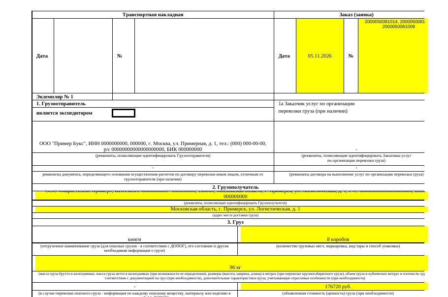

# Генератор ТТН для поставок Ozon

## Задача
На каждую поставку в Ozon нужна транспортная накладная: двухстраничная форма Excel, где вручную заполнялись номера поставок, грузополучатель, адрес, количество мест, вес, сумма, водитель и машина. Одни и те же данные повторялись в нескольких ячейках, ошибки в них возвращали машину со склада.

## Решение
Приложение с окном (Python + tkinter, собирается в .exe). Менеджер вставляет номера поставок, выбирает склад и водителя из списков и получает готовый к печати файл.

- Номера поставок проверяются: 13 цифр, начинаются с 2000; все номера помещаются в ячейку при печати.
- Если дата не указана, подставляется завтрашняя.
- Значения дублируются во все нужные ячейки обоих листов.
- Пустые обязательные поля не мешают создать файл, но выводится предупреждение: какие поля не заполнены.
- Справочники грузополучателей и водителей хранятся в Excel рядом с программой и пополняются из интерфейса.
- Имя файла: `Фамилия_Склад_Дата.xlsx`.

**Результат:** экономия 2–4 часа в неделю менеджера и логиста.



## Запуск
```bash
pip install -r requirements.txt
python ttn_generator.py
```
Сборка .exe для Windows: `build_exe.bat` (шаблон `template_ttn.xlsx` упаковывается внутрь).

---
**EN.** Desktop app (Python, tkinter, openpyxl) that fills in a two-page Russian consignment note (TTN) for Ozon shipments: input validation, warnings for missing fields, editable reference lists of consignees and drivers. Saved 2–4 hours a week. All requisites are fictitious.
