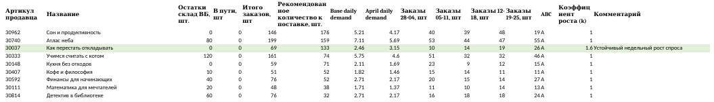

# WB Order Planner — план отгрузки на региональные склады Wildberries

## Задача
Каждую неделю нужно было решать, сколько экземпляров каждой книги отправить на склады WB в четырёх регионах. Вручную это означало сводить четыре недельных отчёта продаж, файл с товарами в пути и считать потребность по сотням артикулов. При этом разовый всплеск продаж легко принять за тренд и отправить лишнее.

## Решение
Сначала я описала алгоритм как подробное ТЗ ([PROMPT.md](PROMPT.md)), и по нему каждую неделю считал ИИ-агент в Cursor. Затем логика вынесена в самостоятельный скрипт, который работает без ИИ и даёт одинаковый результат при каждом запуске.

**Как считается:**
1. Берутся 4 последних недельных отчёта (определяются по датам в имени файла) и актуальный файл «В пути».
2. Названия регионов нормализуются (например, «Южный + Северо-Кавказский» и «Южный и Северо-Кавказский» — один регион).
3. **ABC-анализ** по каждому региону отдельно: группа A — товары, дающие первые 80% заказов. В план попадает только A.
4. **Всплеск**: если одна неделя ≥ 3× среднего по остальным, она исключается из расчёта (строка жёлтая).
5. **Устойчивый рост**: если заказы растут 4 недели подряд, спрос умножается на `k = min(1.6, √(w4/w1))` (строка зелёная).
6. **К поставке** = ⌈спрос в день × (30 дней запаса + 12 дней логистики) − остаток на WB − в пути⌉.
7. Проверки перед сохранением: ненулевые остатки, совпадение «в пути», пересчёт по нескольким SKU.



## Запуск
```bash
pip install -r requirements.txt
python generate_demo_data.py              # вымышленные отчёты в demo_data/
python wb_order_planner.py --input demo_data
python -m pytest                          # тесты расчёта
```
Параметры: `--cover-days 30 --lead-days 12 --season-factor 0.8`.

---
**EN.** Weekly replenishment planner for Wildberries regional warehouses. Per-region ABC analysis, demand forecast with short-term spike exclusion and capped growth factor, netting of WB stock and goods in transit. Started as a detailed prompt for an AI agent in Cursor, then turned into a deterministic Python script. Demo data is fictitious.
